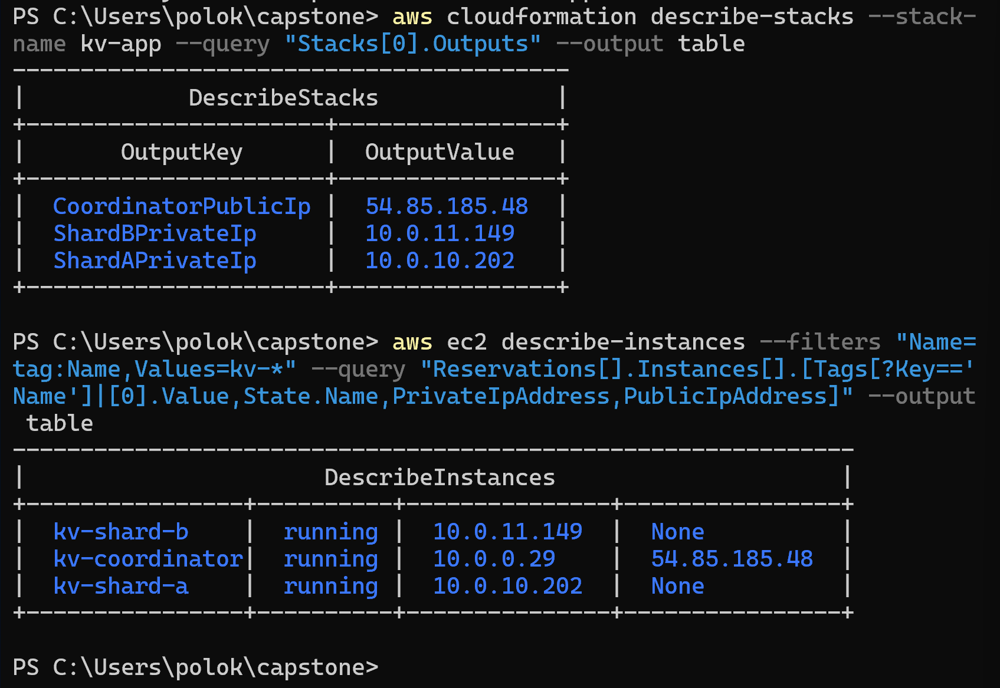

# M2 evidence 0: image folder setup

## What ran
`mkdir docs\img -Force` creates the `docs\img` folder for the screenshots. `-Force` skips the error if the folder already exists.

## Result
The folder exists under `docs`, and the terminal shows its creation.

